# Database Design Document

## Project Title
Secure Smart Apartment & Society Management Platform

## Purpose
This document defines the MySQL database design for the platform at a schema-planning level only. It does not create SQL tables, Spring entities, or backend APIs.

## Recommended Database Name
`ssasm_society_mgmt_db`

This name is short, professional, and specific to a single society deployment while still leaving room for future features.

## Database Design Principles

- MySQL is the target database engine.
- The schema follows Third Normal Form as far as practical for a real-world operational system.
- Duplicate data is avoided by separating master data from transactional data.
- Primary keys are used on every table.
- Foreign keys are used to preserve referential integrity.
- Soft delete is used on operational tables wherever record history matters.
- Major tables include `created_at` and `updated_at` timestamps.
- ENUM is used only for tightly bounded states where a lookup table would add unnecessary complexity.
- Sensitive data is separated from general operational data.
- Administrative access to resident documents is modeled as a request and approval flow, not direct access.

## Step 1: Database Creation

A professional single-society database should be created with the name:

- `ssasm_society_mgmt_db`

This name clearly reflects the application domain, supports a single society deployment, and keeps future cloud or container deployments straightforward.

---

## Step 2: Module-Wise Table List

### 1. Authentication

- `users` - stores login identities for the four allowed roles.
- `roles` - stores the fixed application roles.
- `user_roles` - maps users to roles and supports RBAC expansion.
- `auth_refresh_tokens` - stores refresh token metadata if JWT refresh flow is later enabled.
- `password_reset_tokens` - stores token records for secure password recovery.
- `resident_document_access_requests` - stores admin requests for temporary access to sensitive resident documents.
- `resident_document_access_approvals` - stores resident approval or rejection outcomes.

Why these tables exist:

- Authentication should be separated from profile and domain tables.
- Role data should be centralized.
- Temporary security tokens should not be mixed with user profiles.
- Sensitive-document access must be auditable and approval-based.

### 2. Society Structure

- `societies` - stores the single apartment/society master record.
- `buildings` - stores each building in the society.
- `floors` - stores floor records under each building.
- `flats` - stores individual flat units.

Why these tables exist:

- Society structure should be hierarchical and normalized.
- Buildings, floors, and flats should be modeled separately to avoid repeated text.
- This structure supports future expansion to more buildings and flats.

### 3. Resident Management

- `resident_profiles` - stores resident-specific profile information.
- `resident_flat_assignments` - maps residents to flats and supports ownership or occupancy history.
- `resident_family_members` - stores family members or co-occupants linked to a resident record.
- `resident_documents` - stores metadata for sensitive documents such as ID proof or ownership proof.
- `resident_document_access_requests` - shared with authentication for controlled document access.
- `resident_document_access_approvals` - shared with authentication for approval tracking.

Why these tables exist:

- Resident profile data must be separated from login credentials.
- A resident can be linked to one or more flat assignments over time.
- Document metadata should be stored independently from the binary file itself.
- Household members are different from login users and should not be confused with authentication records.

### 4. Visitor & Identity Access Management

- `visitor_categories` - stores the supported visitor types such as trusted visitor, temporary visitor, service provider, technician, or courier.
- `visitors` - stores visitor identity details.
- `visitor_visit_requests` - stores approval requests for one-time visitors.
- `visitor_visit_approvals` - stores resident approval or rejection for visits.
- `visitor_entry_logs` - stores entry timestamps and guard verification data.
- `visitor_exit_logs` - stores exit timestamps.
- `trusted_visitors` - stores trusted visitor status for faster access.
- `service_provider_profiles` - stores registered service provider details.
- `service_provider_access_rules` - stores allowed days, allowed time, and validity period.
- `service_provider_flat_assignments` - maps service providers to assigned flats.
- `visitor_block_list` - stores blocked identity records.

Why these tables exist:

- Visitor identity and visit activity must be separate.
- Approval flow for temporary visitors must be auditable.
- Trusted visitors require a durable allow-list model.
- Registered service providers need additional access constraints.
- Entry and exit history should remain immutable for auditability.

### 5. Complaint Management

- `complaint_categories` - stores complaint types.
- `complaints` - stores complaint records raised by residents.
- `complaint_assignments` - stores assignment to a staff member.
- `complaint_status_history` - stores all status transitions.
- `complaint_comments` - stores conversation or internal updates.

Why these tables exist:

- Complaint data should be split from category and workflow history.
- Assignments should not be overwritten because history matters.
- Status history is essential for accountability.

### 6. Maintenance Billing

- `billing_cycles` - stores monthly or periodic billing cycles.
- `maintenance_invoices` - stores resident maintenance invoices.
- `maintenance_invoice_items` - stores itemized charges if needed later.
- `maintenance_payments` - stores payment records and references.
- `billing_adjustments` - stores waivers, penalties, or manual corrections.

Why these tables exist:

- Billing needs separation between cycle, invoice, payment, and adjustment.
- Itemization keeps the schema extensible for future fee types.
- Payments should not be embedded directly into invoice rows.

### 7. Vehicle & Parking

- `vehicles` - stores resident or household vehicle data.
- `parking_slots` - stores parking slot inventory.
- `parking_allocations` - stores assigned slot ownership or tenancy.
- `parking_visits` - stores temporary parking entries if required later.

Why these tables exist:

- Vehicles should be separate from parking spaces.
- Slot allocation is a relationship, not a flat attribute.
- Parking use can change over time, so allocation history matters.

### 8. Facility Booking

- `facilities` - stores bookable society facilities.
- `facility_booking_rules` - stores booking constraints and fee rules.
- `facility_bookings` - stores booking requests and confirmations.
- `facility_booking_payments` - stores payment references for paid bookings.
- `facility_booking_slots` - stores time-slot granularity if needed.

Why these tables exist:

- Facilities are master data.
- Booking rules should not be hardcoded in application logic.
- Booking and payment history must be separable.

### 9. Staff Management

- `staff_profiles` - stores staff personal and contact details.
- `staff_roles` - stores operational staff job categories if separate from login roles.
- `staff_shift_rosters` - stores shift timing and assignment data.
- `staff_task_assignments` - stores tasks assigned to staff.

Why these tables exist:

- Login identity and staff profile should not be merged.
- Shift and task data are operational and should have history.
- Staff responsibilities can evolve over time.

### 10. Community Marketplace

- `marketplace_categories` - stores listing categories.
- `marketplace_listings` - stores goods or services posted by residents.
- `marketplace_listing_media` - stores images or attachments metadata.
- `marketplace_inquiries` - stores buyer or interested-user messages.
- `marketplace_transactions` - stores optional exchange or sale records if enabled later.

Why these tables exist:

- Listings, media, inquiries, and transactions should be normalized.
- Marketplace activity is separate from society operations.

### 11. To-Let Management

- `tolet_listings` - stores flat rental advertisements.
- `tolet_inquiries` - stores leads or enquiries.
- `tolet_visits` - stores schedule records for property visits.
- `tolet_listing_media` - stores images or brochure metadata.

Why these tables exist:

- To-let data is distinct from occupied resident data.
- Lead handling should remain independent from the listing master.

### 12. Service Booking

- `service_categories` - stores supported service types.
- `service_providers_directory` - stores vendor or provider profiles.
- `service_bookings` - stores booking requests from residents.
- `service_booking_assignments` - stores allocation to a provider.
- `service_booking_status_history` - stores workflow changes.

Why these tables exist:

- Services need category, request, assignment, and history separation.
- This model supports both in-house and external service providers.

### 13. Parcel Management

- `parcel_records` - stores parcel arrival and recipient details.
- `parcel_status_history` - stores pickup and release workflow history.
- `parcel_handover_logs` - stores guard handover confirmation details.

Why these tables exist:

- Parcel management must preserve arrival and handover history.
- Status history helps resolve disputes.

### 14. Notification System

- `notifications` - stores system-generated notification content.
- `notification_recipients` - stores per-user delivery state.
- `notification_templates` - stores reusable message templates.
- `notification_delivery_logs` - stores delivery attempt records.

Why these tables exist:

- Notifications are one message to many recipients.
- Recipient state must be tracked independently.
- Templates reduce duplication and improve consistency.

### 15. Audit Logs

- `audit_logs` - stores security-relevant user and system actions.
- `audit_log_details` - stores optional structured context when a single audit record needs more detail.

Why these tables exist:

- Audit data must be immutable or append-only.
- Detailed structured events should not be mixed with operational data.

---

## Step 3: Table Specification Summary

### Authentication Tables

| Table | Purpose | Primary Key | Important Columns | Foreign Keys | Relationships |
|---|---|---|---|---|---|
| `users` | Stores application login accounts | `user_id` | `full_name`, `email`, `phone_number`, `password_hash`, `account_status`, `last_login_at`, `is_deleted`, `created_at`, `updated_at` | None directly for core identity | One user to many roles through `user_roles`; one user to many notifications, complaints, bookings, or logs |
| `roles` | Stores role master data | `role_id` | `role_name`, `role_code`, `description`, `is_active` | None | One role to many users through `user_roles` |
| `user_roles` | Maps users to roles | Composite or surrogate key | `user_id`, `role_id`, `assigned_at` | `user_id` → `users`, `role_id` → `roles` | Many-to-many between users and roles |
| `auth_refresh_tokens` | Stores refresh token metadata | `token_id` | `user_id`, `token_hash`, `expires_at`, `revoked_at` | `user_id` → `users` | One user to many tokens |
| `password_reset_tokens` | Stores password reset records | `reset_token_id` | `user_id`, `token_hash`, `expires_at`, `used_at` | `user_id` → `users` | One user to many reset tokens |
| `resident_document_access_requests` | Stores resident document access requests from admin | `request_id` | `requested_by_user_id`, `resident_id`, `purpose`, `requested_at`, `request_status` | `requested_by_user_id` → `users`, `resident_id` → `resident_profiles` | One resident to many access requests |
| `resident_document_access_approvals` | Stores approval decisions | `approval_id` | `request_id`, `resident_id`, `decision`, `decision_at`, `remarks` | `request_id` → `resident_document_access_requests`, `resident_id` → `resident_profiles` | One request to one decision row |

### Society Structure Tables

| Table | Purpose | Primary Key | Important Columns | Foreign Keys | Relationships |
|---|---|---|---|---|---|
| `societies` | Master society record | `society_id` | `society_name`, `registration_number`, `address_line1`, `city`, `state`, `pincode`, `contact_phone`, `contact_email`, `is_deleted`, `created_at`, `updated_at` | None | One society to many buildings |
| `buildings` | Building master | `building_id` | `society_id`, `building_name`, `building_code`, `total_floors`, `is_deleted`, `created_at`, `updated_at` | `society_id` → `societies` | One building to many floors |
| `floors` | Floor master | `floor_id` | `building_id`, `floor_number`, `floor_label`, `is_deleted`, `created_at`, `updated_at` | `building_id` → `buildings` | One floor to many flats |
| `flats` | Flat master | `flat_id` | `floor_id`, `flat_number`, `flat_type`, `carpet_area`, `status`, `is_deleted`, `created_at`, `updated_at` | `floor_id` → `floors` | One flat to many resident assignments, vehicles, complaints, bookings, parcels |

### Resident Tables

| Table | Purpose | Primary Key | Important Columns | Foreign Keys | Relationships |
|---|---|---|---|---|---|
| `resident_profiles` | Resident profile data | `resident_id` | `user_id`, `resident_code`, `date_of_birth`, `gender`, `occupation`, `emergency_contact_name`, `emergency_contact_phone`, `is_deleted`, `created_at`, `updated_at` | `user_id` → `users` | One user to one resident profile; one resident to many assignments, complaints, parcels, bookings |
| `resident_flat_assignments` | Resident-to-flat mapping | `assignment_id` | `resident_id`, `flat_id`, `occupancy_type`, `move_in_date`, `move_out_date`, `is_primary_resident`, `is_deleted`, `created_at`, `updated_at` | `resident_id` → `resident_profiles`, `flat_id` → `flats` | Many residents to many flats over time |
| `resident_family_members` | Family members and co-occupants | `family_member_id` | `resident_id`, `full_name`, `relation`, `phone_number`, `is_primary_user`, `is_deleted`, `created_at`, `updated_at` | `resident_id` → `resident_profiles` | One resident to many family members |
| `resident_documents` | Sensitive resident document metadata | `document_id` | `resident_id`, `document_type`, `document_number_masked`, `file_path`, `file_hash`, `verification_status`, `is_deleted`, `created_at`, `updated_at` | `resident_id` → `resident_profiles` | One resident to many documents |

### Visitor Tables

| Table | Purpose | Primary Key | Important Columns | Foreign Keys | Relationships |
|---|---|---|---|---|---|
| `visitor_categories` | Visitor type master | `category_id` | `category_name`, `category_code`, `is_active` | None | One category to many visitors |
| `visitors` | Visitor identity record | `visitor_id` | `category_id`, `full_name`, `phone_number`, `government_id_type`, `government_id_number_masked`, `photo_path`, `is_blocked`, `is_deleted`, `created_at`, `updated_at` | `category_id` → `visitor_categories` | One visitor to many visit requests or entry logs |
| `visitor_visit_requests` | Approval request for one-time visitor | `visit_request_id` | `visitor_id`, `resident_id`, `flat_id`, `visit_date`, `purpose`, `requested_by_user_id`, `request_status`, `is_deleted`, `created_at`, `updated_at` | `visitor_id` → `visitors`, `resident_id` → `resident_profiles`, `flat_id` → `flats`, `requested_by_user_id` → `users` | One resident to many visit requests |
| `visitor_visit_approvals` | Resident approval result | `approval_id` | `visit_request_id`, `resident_id`, `decision`, `decision_at`, `remarks` | `visit_request_id` → `visitor_visit_requests`, `resident_id` → `resident_profiles` | One request to one decision record |
| `visitor_entry_logs` | Guard entry verification log | `entry_log_id` | `visitor_id`, `flat_id`, `verified_by_user_id`, `entry_time`, `verified_phone`, `verified_photo_match`, `verified_validity`, `decision`, `is_deleted`, `created_at`, `updated_at` | `visitor_id` → `visitors`, `flat_id` → `flats`, `verified_by_user_id` → `users` | One visitor to many entry logs |
| `visitor_exit_logs` | Guard exit log | `exit_log_id` | `entry_log_id`, `exit_time`, `verified_by_user_id`, `is_deleted`, `created_at`, `updated_at` | `entry_log_id` → `visitor_entry_logs`, `verified_by_user_id` → `users` | One entry log to one exit log |
| `trusted_visitors` | Trusted visitor allow-list | `trusted_visitor_id` | `resident_id`, `visitor_id`, `trusted_since`, `trusted_until`, `status`, `is_deleted`, `created_at`, `updated_at` | `resident_id` → `resident_profiles`, `visitor_id` → `visitors` | Many trusted visitor records per resident |
| `service_provider_profiles` | Registered service provider master | `service_provider_id` | `visitor_id`, `service_type`, `assigned_flat_id`, `government_id_verified`, `is_blocked`, `is_deleted`, `created_at`, `updated_at` | `visitor_id` → `visitors`, `assigned_flat_id` → `flats` | One service provider to one or many flat assignments |
| `service_provider_access_rules` | Access timing and validity | `access_rule_id` | `service_provider_id`, `allowed_days`, `allowed_start_time`, `allowed_end_time`, `valid_from`, `valid_to`, `is_deleted`, `created_at`, `updated_at` | `service_provider_id` → `service_provider_profiles` | One provider to many access rule records over time |
| `service_provider_flat_assignments` | Maps provider to flat | `assignment_id` | `service_provider_id`, `flat_id`, `is_active`, `is_deleted`, `created_at`, `updated_at` | `service_provider_id` → `service_provider_profiles`, `flat_id` → `flats` | Many-to-many across providers and flats |
| `visitor_block_list` | Blocked visitor identity records | `block_id` | `visitor_id`, `blocked_by_user_id`, `block_reason`, `blocked_at`, `is_deleted`, `created_at`, `updated_at` | `visitor_id` → `visitors`, `blocked_by_user_id` → `users` | One visitor to many block history rows |

### Complaint Tables

| Table | Purpose | Primary Key | Important Columns | Foreign Keys | Relationships |
|---|---|---|---|---|---|
| `complaint_categories` | Complaint master categories | `category_id` | `category_name`, `priority_level`, `is_active` | None | One category to many complaints |
| `complaints` | Resident complaint records | `complaint_id` | `resident_id`, `flat_id`, `category_id`, `subject`, `description`, `priority`, `status`, `is_deleted`, `created_at`, `updated_at` | `resident_id` → `resident_profiles`, `flat_id` → `flats`, `category_id` → `complaint_categories` | One resident to many complaints |
| `complaint_assignments` | Complaint handling assignment | `assignment_id` | `complaint_id`, `staff_member_id`, `assigned_by_user_id`, `assigned_at`, `assignment_status` | `complaint_id` → `complaints`, `staff_member_id` → `staff_profiles`, `assigned_by_user_id` → `users` | One complaint to many assignment history records |
| `complaint_status_history` | Complaint workflow history | `status_history_id` | `complaint_id`, `status`, `changed_by_user_id`, `changed_at`, `remarks` | `complaint_id` → `complaints`, `changed_by_user_id` → `users` | One complaint to many status changes |
| `complaint_comments` | Resident/staff comment thread | `comment_id` | `complaint_id`, `commented_by_user_id`, `comment_text`, `is_internal`, `created_at`, `updated_at` | `complaint_id` → `complaints`, `commented_by_user_id` → `users` | One complaint to many comments |

### Billing Tables

| Table | Purpose | Primary Key | Important Columns | Foreign Keys | Relationships |
|---|---|---|---|---|---|
| `billing_cycles` | Billing period master | `cycle_id` | `cycle_name`, `billing_month`, `billing_year`, `due_date`, `status`, `is_deleted`, `created_at`, `updated_at` | None | One cycle to many invoices |
| `maintenance_invoices` | Resident billing invoice | `invoice_id` | `cycle_id`, `resident_id`, `flat_id`, `invoice_number`, `subtotal_amount`, `penalty_amount`, `discount_amount`, `total_amount`, `status`, `is_deleted`, `created_at`, `updated_at` | `cycle_id` → `billing_cycles`, `resident_id` → `resident_profiles`, `flat_id` → `flats` | One resident to many invoices; one cycle to many invoices |
| `maintenance_invoice_items` | Itemized invoice entries | `invoice_item_id` | `invoice_id`, `charge_label`, `charge_amount`, `tax_amount`, `line_total` | `invoice_id` → `maintenance_invoices` | One invoice to many items |
| `maintenance_payments` | Payment records | `payment_id` | `invoice_id`, `payment_reference`, `payment_mode`, `paid_amount`, `paid_at`, `payment_status`, `gateway_name`, `gateway_payload_ref` | `invoice_id` → `maintenance_invoices` | One invoice to many payment records if partial payments are allowed |
| `billing_adjustments` | Waivers and corrections | `adjustment_id` | `invoice_id`, `adjustment_type`, `adjustment_amount`, `reason`, `created_by_user_id`, `created_at`, `updated_at` | `invoice_id` → `maintenance_invoices`, `created_by_user_id` → `users` | One invoice to many adjustments |

### Vehicle and Parking Tables

| Table | Purpose | Primary Key | Important Columns | Foreign Keys | Relationships |
|---|---|---|---|---|---|
| `vehicles` | Resident vehicle master | `vehicle_id` | `resident_id`, `vehicle_type`, `vehicle_number`, `brand`, `model`, `color`, `is_active`, `is_deleted`, `created_at`, `updated_at` | `resident_id` → `resident_profiles` | One resident to many vehicles |
| `parking_slots` | Parking slot master | `slot_id` | `slot_code`, `slot_type`, `level`, `status`, `is_active` | None | One slot to many allocations over time |
| `parking_allocations` | Slot assignment history | `allocation_id` | `slot_id`, `vehicle_id`, `resident_id`, `allocated_from`, `allocated_until`, `status`, `is_deleted`, `created_at`, `updated_at` | `slot_id` → `parking_slots`, `vehicle_id` → `vehicles`, `resident_id` → `resident_profiles` | Many-to-many over time between vehicles and slots |
| `parking_visits` | Optional temporary parking usage | `parking_visit_id` | `vehicle_id`, `slot_id`, `entry_time`, `exit_time`, `verified_by_user_id`, `created_at`, `updated_at` | `vehicle_id` → `vehicles`, `slot_id` → `parking_slots`, `verified_by_user_id` → `users` | One slot to many temporary visit records |

### Facility Booking Tables

| Table | Purpose | Primary Key | Important Columns | Foreign Keys | Relationships |
|---|---|---|---|---|---|
| `facilities` | Facility master | `facility_id` | `facility_name`, `facility_type`, `capacity`, `status`, `is_active` | None | One facility to many bookings |
| `facility_booking_rules` | Booking constraints and fee rules | `rule_id` | `facility_id`, `booking_window_days`, `slot_duration_minutes`, `max_bookings_per_resident`, `fee_amount`, `security_deposit`, `is_deleted`, `created_at`, `updated_at` | `facility_id` → `facilities` | One facility to many rule versions |
| `facility_bookings` | Booking records | `booking_id` | `facility_id`, `resident_id`, `flat_id`, `booking_date`, `start_time`, `end_time`, `status`, `purpose`, `is_deleted`, `created_at`, `updated_at` | `facility_id` → `facilities`, `resident_id` → `resident_profiles`, `flat_id` → `flats` | One resident to many bookings; one facility to many bookings |
| `facility_booking_payments` | Payment for facility booking | `payment_id` | `booking_id`, `amount`, `payment_reference`, `payment_status`, `paid_at` | `booking_id` → `facility_bookings` | One booking to one or many payment rows if needed |
| `facility_booking_slots` | Detailed slot timeline | `booking_slot_id` | `booking_id`, `slot_start`, `slot_end` | `booking_id` → `facility_bookings` | One booking to many slot rows if required |

### Staff Tables

| Table | Purpose | Primary Key | Important Columns | Foreign Keys | Relationships |
|---|---|---|---|---|---|
| `staff_profiles` | Staff identity details | `staff_id` | `user_id`, `employee_code`, `full_name`, `phone_number`, `designation`, `joining_date`, `is_active`, `is_deleted`, `created_at`, `updated_at` | `user_id` → `users` | One user to one staff profile |
| `staff_roles` | Operational staff categories | `staff_role_id` | `role_name`, `role_description`, `is_active` | None | One staff role to many staff profiles if used |
| `staff_shift_rosters` | Shift schedule | `shift_id` | `staff_id`, `shift_date`, `shift_start`, `shift_end`, `shift_status`, `created_at`, `updated_at` | `staff_id` → `staff_profiles` | One staff member to many shifts |
| `staff_task_assignments` | Staff task workflow | `task_id` | `staff_id`, `task_title`, `task_description`, `assigned_by_user_id`, `due_at`, `task_status`, `created_at`, `updated_at` | `staff_id` → `staff_profiles`, `assigned_by_user_id` → `users` | One staff member to many tasks |

### Marketplace Tables

| Table | Purpose | Primary Key | Important Columns | Foreign Keys | Relationships |
|---|---|---|---|---|---|
| `marketplace_categories` | Listing categories | `category_id` | `category_name`, `is_active` | None | One category to many listings |
| `marketplace_listings` | Marketplace items or services | `listing_id` | `category_id`, `posted_by_resident_id`, `title`, `description`, `asking_price`, `status`, `is_deleted`, `created_at`, `updated_at` | `category_id` → `marketplace_categories`, `posted_by_resident_id` → `resident_profiles` | One resident to many listings |
| `marketplace_listing_media` | Listing images | `media_id` | `listing_id`, `media_path`, `media_type`, `sort_order` | `listing_id` → `marketplace_listings` | One listing to many media rows |
| `marketplace_inquiries` | Buyer or interested-user messages | `inquiry_id` | `listing_id`, `inquired_by_user_id`, `message_text`, `created_at`, `updated_at` | `listing_id` → `marketplace_listings`, `inquired_by_user_id` → `users` | One listing to many inquiries |
| `marketplace_transactions` | Optional trade or sale record | `transaction_id` | `listing_id`, `buyer_user_id`, `seller_resident_id`, `transaction_amount`, `transaction_status`, `created_at`, `updated_at` | `listing_id` → `marketplace_listings`, `buyer_user_id` → `users`, `seller_resident_id` → `resident_profiles` | One listing to many transactions if a multi-step workflow is later needed |

### To-Let Tables

| Table | Purpose | Primary Key | Important Columns | Foreign Keys | Relationships |
|---|---|---|---|---|---|
| `tolet_listings` | Flat availability listing | `tolet_listing_id` | `flat_id`, `posted_by_user_id`, `rent_amount`, `deposit_amount`, `available_from`, `status`, `is_deleted`, `created_at`, `updated_at` | `flat_id` → `flats`, `posted_by_user_id` → `users` | One flat to many listings over time |
| `tolet_inquiries` | Lead capture for rentals | `tolet_inquiry_id` | `tolet_listing_id`, `inquirer_name`, `phone_number`, `email`, `message`, `created_at`, `updated_at` | `tolet_listing_id` → `tolet_listings` | One listing to many inquiries |
| `tolet_visits` | Visit scheduling | `visit_id` | `tolet_listing_id`, `scheduled_at`, `visitor_name`, `visitor_phone`, `status`, `created_at`, `updated_at` | `tolet_listing_id` → `tolet_listings` | One listing to many visits |
| `tolet_listing_media` | Photos and brochure metadata | `media_id` | `tolet_listing_id`, `media_path`, `media_type`, `sort_order` | `tolet_listing_id` → `tolet_listings` | One listing to many media rows |

### Service Booking Tables

| Table | Purpose | Primary Key | Important Columns | Foreign Keys | Relationships |
|---|---|---|---|---|---|
| `service_categories` | Service type master | `category_id` | `category_name`, `is_active` | None | One category to many bookings |
| `service_providers_directory` | Service provider master | `provider_id` | `provider_name`, `phone_number`, `service_category_id`, `is_verified`, `is_active`, `created_at`, `updated_at` | `service_category_id` → `service_categories` | One category to many providers |
| `service_bookings` | Resident service requests | `booking_id` | `resident_id`, `flat_id`, `service_category_id`, `provider_id`, `requested_date`, `requested_time`, `status`, `notes`, `is_deleted`, `created_at`, `updated_at` | `resident_id` → `resident_profiles`, `flat_id` → `flats`, `service_category_id` → `service_categories`, `provider_id` → `service_providers_directory` | One resident to many service bookings |
| `service_booking_assignments` | Booking allocation history | `assignment_id` | `booking_id`, `provider_id`, `assigned_by_user_id`, `assigned_at`, `assignment_status` | `booking_id` → `service_bookings`, `provider_id` → `service_providers_directory`, `assigned_by_user_id` → `users` | One booking to many assignments over time |
| `service_booking_status_history` | Status workflow history | `status_history_id` | `booking_id`, `status`, `changed_by_user_id`, `changed_at`, `remarks` | `booking_id` → `service_bookings`, `changed_by_user_id` → `users` | One booking to many status changes |

### Parcel Tables

| Table | Purpose | Primary Key | Important Columns | Foreign Keys | Relationships |
|---|---|---|---|---|---|
| `parcel_records` | Parcel arrival records | `parcel_id` | `resident_id`, `flat_id`, `courier_name`, `tracking_number`, `parcel_type`, `received_by_user_id`, `received_at`, `status`, `is_deleted`, `created_at`, `updated_at` | `resident_id` → `resident_profiles`, `flat_id` → `flats`, `received_by_user_id` → `users` | One resident to many parcels |
| `parcel_status_history` | Parcel workflow history | `status_history_id` | `parcel_id`, `status`, `changed_by_user_id`, `changed_at`, `remarks` | `parcel_id` → `parcel_records`, `changed_by_user_id` → `users` | One parcel to many status history rows |
| `parcel_handover_logs` | Guard handover confirmation | `handover_id` | `parcel_id`, `handover_to_name`, `handover_to_phone`, `verified_by_user_id`, `handed_over_at`, `created_at`, `updated_at` | `parcel_id` → `parcel_records`, `verified_by_user_id` → `users` | One parcel to one handover log or a controlled sequence of logs |

### Notification Tables

| Table | Purpose | Primary Key | Important Columns | Foreign Keys | Relationships |
|---|---|---|---|---|---|
| `notifications` | Notification master content | `notification_id` | `notification_type`, `title`, `message_body`, `created_by_user_id`, `created_at`, `updated_at` | `created_by_user_id` → `users` | One notification to many recipients |
| `notification_recipients` | Per-user delivery state | `recipient_id` | `notification_id`, `user_id`, `delivery_status`, `read_at`, `delivered_at` | `notification_id` → `notifications`, `user_id` → `users` | Many-to-many between notifications and users |
| `notification_templates` | Reusable templates | `template_id` | `template_name`, `template_key`, `template_body`, `is_active`, `created_at`, `updated_at` | None | One template to many generated notifications |
| `notification_delivery_logs` | Delivery attempts | `delivery_log_id` | `recipient_id`, `attempt_time`, `channel_name`, `delivery_status`, `error_message` | `recipient_id` → `notification_recipients` | One recipient to many delivery attempts |

### Audit Tables

| Table | Purpose | Primary Key | Important Columns | Foreign Keys | Relationships |
|---|---|---|---|---|---|
| `audit_logs` | Security and action log | `audit_log_id` | `actor_user_id`, `action_type`, `module_name`, `entity_name`, `entity_id`, `action_status`, `ip_address`, `user_agent`, `created_at` | `actor_user_id` → `users` | One user to many audit logs |
| `audit_log_details` | Optional structured details | `detail_id` | `audit_log_id`, `detail_key`, `detail_value` | `audit_log_id` → `audit_logs` | One audit log to many details |

---

## Step 4: Relationship Design

### One-to-One

A one-to-one relationship is used when a record has exactly one matching record in another table.

Examples:

- `users` to `resident_profiles` for resident login identity and resident profile.
- `users` to `staff_profiles` for staff login identity and staff profile.
- `resident_document_access_requests` to `resident_document_access_approvals` for a single approval decision per request.
- `visitor_visit_requests` to `visitor_visit_approvals` for a single resident decision per request.
- `parcel_records` to `parcel_handover_logs` when a single handover record is sufficient.

### One-to-Many

A one-to-many relationship is used when one parent record can have many child records.

Examples:

- `societies` to `buildings`
- `buildings` to `floors`
- `floors` to `flats`
- `flats` to `complaints`
- `resident_profiles` to `complaints`
- `resident_profiles` to `maintenance_invoices`
- `resident_profiles` to `visitor_visit_requests`
- `resident_profiles` to `vehicles`
- `facilities` to `facility_bookings`
- `notifications` to `notification_recipients`
- `audit_logs` to `audit_log_details`

### Many-to-Many

A many-to-many relationship is used when many records in one table can relate to many records in another table. In a relational database, this is implemented using a junction table.

Examples:

- `users` and `roles` through `user_roles`
- `service_provider_profiles` and `flats` through `service_provider_flat_assignments`
- `visitors` and `resident_profiles` through `trusted_visitors`
- `parking_slots` and `vehicles` through `parking_allocations`
- `notifications` and `users` through `notification_recipients`

### Relationship Summary by Module

- Authentication: one user can have one or more roles; one role can belong to many users.
- Society Structure: one society contains many buildings; one building contains many floors; one floor contains many flats.
- Resident Management: one resident can have many flat assignments, documents, family members, complaints, vehicles, and invoices.
- Visitor Management: one visitor can generate many visit requests and entry logs; one resident can approve many visits.
- Complaint Management: one complaint can have many assignments, comments, and status changes.
- Billing: one billing cycle can produce many invoices; one invoice can have multiple items and payments.
- Parking: one vehicle can have many historical allocations; one slot can be assigned multiple times over time.
- Facility Booking: one facility can be booked many times.
- Staff: one staff member can have many shifts and tasks.
- Marketplace: one listing can have many images and inquiries.
- To-Let: one flat can have many historical listings.
- Service Booking: one request can have many assignment or status-history rows.
- Parcel: one parcel can have one or more status events.
- Notifications: one notification can be delivered to many users.
- Audit: one actor can generate many audit records.

---

## Step 5: ER Diagram in Text Form

```mermaid
erDiagram
    SOCIETIES ||--o{ BUILDINGS : contains
    BUILDINGS ||--o{ FLOORS : contains
    FLOORS ||--o{ FLATS : contains

    USERS ||--o| RESIDENT_PROFILES : owns
    USERS ||--o| STAFF_PROFILES : owns
    USERS ||--o{ USER_ROLES : assigned
    ROLES ||--o{ USER_ROLES : mapped

    RESIDENT_PROFILES ||--o{ RESIDENT_FLAT_ASSIGNMENTS : assigned
    FLATS ||--o{ RESIDENT_FLAT_ASSIGNMENTS : occupied_by
    RESIDENT_PROFILES ||--o{ RESIDENT_FAMILY_MEMBERS : has
    RESIDENT_PROFILES ||--o{ RESIDENT_DOCUMENTS : stores

    VISITOR_CATEGORIES ||--o{ VISITORS : classifies
    VISITORS ||--o{ VISITOR_VISIT_REQUESTS : requested_for
    RESIDENT_PROFILES ||--o{ VISITOR_VISIT_REQUESTS : approves
    FLATS ||--o{ VISITOR_VISIT_REQUESTS : for_flat
    VISITOR_VISIT_REQUESTS ||--o| VISITOR_VISIT_APPROVALS : decided_by
    VISITORS ||--o{ VISITOR_ENTRY_LOGS : enters
    VISITOR_ENTRY_LOGS ||--o| VISITOR_EXIT_LOGS : exits
    RESIDENT_PROFILES ||--o{ TRUSTED_VISITORS : trusts
    VISITORS ||--o{ TRUSTED_VISITORS : trusted_as
    VISITORS ||--o| SERVICE_PROVIDER_PROFILES : specialized_as
    SERVICE_PROVIDER_PROFILES ||--o{ SERVICE_PROVIDER_ACCESS_RULES : governed_by
    SERVICE_PROVIDER_PROFILES ||--o{ SERVICE_PROVIDER_FLAT_ASSIGNMENTS : assigned_to
    FLATS ||--o{ SERVICE_PROVIDER_FLAT_ASSIGNMENTS : receives

    COMPLAINT_CATEGORIES ||--o{ COMPLAINTS : categorizes
    RESIDENT_PROFILES ||--o{ COMPLAINTS : raises
    FLATS ||--o{ COMPLAINTS : reported_for
    COMPLAINTS ||--o{ COMPLAINT_ASSIGNMENTS : assigned
    STAFF_PROFILES ||--o{ COMPLAINT_ASSIGNMENTS : handles
    COMPLAINTS ||--o{ COMPLAINT_STATUS_HISTORY : changes
    COMPLAINTS ||--o{ COMPLAINT_COMMENTS : comments

    BILLING_CYCLES ||--o{ MAINTENANCE_INVOICES : generates
    RESIDENT_PROFILES ||--o{ MAINTENANCE_INVOICES : billed
    FLATS ||--o{ MAINTENANCE_INVOICES : charged_for
    MAINTENANCE_INVOICES ||--o{ MAINTENANCE_INVOICE_ITEMS : contains
    MAINTENANCE_INVOICES ||--o{ MAINTENANCE_PAYMENTS : paid_by
    MAINTENANCE_INVOICES ||--o{ BILLING_ADJUSTMENTS : adjusted_by

    RESIDENT_PROFILES ||--o{ VEHICLES : owns
    PARKING_SLOTS ||--o{ PARKING_ALLOCATIONS : allocated
    VEHICLES ||--o{ PARKING_ALLOCATIONS : receives
    RESIDENT_PROFILES ||--o{ PARKING_ALLOCATIONS : benefits

    FACILITIES ||--o{ FACILITY_BOOKING_RULES : governed_by
    FACILITIES ||--o{ FACILITY_BOOKINGS : booked
    RESIDENT_PROFILES ||--o{ FACILITY_BOOKINGS : makes
    FLATS ||--o{ FACILITY_BOOKINGS : for_flat
    FACILITY_BOOKINGS ||--o{ FACILITY_BOOKING_PAYMENTS : paid_by
    FACILITY_BOOKINGS ||--o{ FACILITY_BOOKING_SLOTS : time_block

    USERS ||--o| STAFF_PROFILES : owns
    STAFF_PROFILES ||--o{ STAFF_SHIFT_ROSTERS : works
    STAFF_PROFILES ||--o{ STAFF_TASK_ASSIGNMENTS : performs

    MARKETPLACE_CATEGORIES ||--o{ MARKETPLACE_LISTINGS : categorizes
    RESIDENT_PROFILES ||--o{ MARKETPLACE_LISTINGS : posts
    MARKETPLACE_LISTINGS ||--o{ MARKETPLACE_LISTING_MEDIA : has
    MARKETPLACE_LISTINGS ||--o{ MARKETPLACE_INQUIRIES : receives
    MARKETPLACE_LISTINGS ||--o{ MARKETPLACE_TRANSACTIONS : tracks

    FLATS ||--o{ TOLET_LISTINGS : advertised_as
    TOLET_LISTINGS ||--o{ TOLET_INQUIRIES : receives
    TOLET_LISTINGS ||--o{ TOLET_VISITS : scheduled
    TOLET_LISTINGS ||--o{ TOLET_LISTING_MEDIA : shows

    SERVICE_CATEGORIES ||--o{ SERVICE_PROVIDERS_DIRECTORY : groups
    SERVICE_CATEGORIES ||--o{ SERVICE_BOOKINGS : requested
    SERVICE_PROVIDERS_DIRECTORY ||--o{ SERVICE_BOOKINGS : fulfills
    RESIDENT_PROFILES ||--o{ SERVICE_BOOKINGS : requests
    FLATS ||--o{ SERVICE_BOOKINGS : for_flat
    SERVICE_BOOKINGS ||--o{ SERVICE_BOOKING_ASSIGNMENTS : assigned
    SERVICE_BOOKINGS ||--o{ SERVICE_BOOKING_STATUS_HISTORY : progresses

    RESIDENT_PROFILES ||--o{ PARCEL_RECORDS : receives
    FLATS ||--o{ PARCEL_RECORDS : addressed_to
    PARCEL_RECORDS ||--o{ PARCEL_STATUS_HISTORY : progresses
    PARCEL_RECORDS ||--o{ PARCEL_HANDOVER_LOGS : handed_over

    USERS ||--o{ NOTIFICATIONS : creates
    NOTIFICATIONS ||--o{ NOTIFICATION_RECIPIENTS : delivered_to
    USERS ||--o{ NOTIFICATION_RECIPIENTS : receives
    NOTIFICATIONS ||--o{ NOTIFICATION_TEMPLATES : based_on
    NOTIFICATION_RECIPIENTS ||--o{ NOTIFICATION_DELIVERY_LOGS : attempts

    USERS ||--o{ AUDIT_LOGS : generates
    AUDIT_LOGS ||--o{ AUDIT_LOG_DETAILS : expands
```

---

## Step 6: Data Flow Between Modules

### Visitor Entry Flow

Resident
↓
Creates visitor request
↓
Visitor request is stored
↓
Resident approves or rejects
↓
Security guard verifies phone, photo, assigned flat, current time, and validity
↓
Entry log is created
↓
Exit log is created later
↓
Notification is sent to resident and optionally the guard log trail is stored in audit logs

### Maintenance Billing Flow

Billing cycle is created
↓
Invoices are generated per flat or resident assignment
↓
Invoice items and totals are stored
↓
Resident pays online or offline
↓
Payment status is updated
↓
Receipt and notification are recorded
↓
Audit log captures billing events

### Facility Booking Flow

Resident checks facility availability
↓
Booking request is created
↓
Booking rule validation is applied
↓
Payment is captured if required
↓
Booking is confirmed
↓
Notification is sent to resident and staff
↓
Audit log stores the action trail

### Marketplace Flow

Resident posts listing
↓
Listing media is saved
↓
Other residents submit inquiry
↓
Optional transaction or exchange record is created
↓
Notification is sent to seller and interested users
↓
Audit logs capture listing edits and deletion events

### Parcel Management Flow

Parcel arrives at security desk
↓
Parcel record is created
↓
Resident is notified
↓
Parcel status is updated when the resident collects it
↓
Handover log is stored
↓
Audit log records the parcel handover action

### Complaint Flow

Resident raises complaint
↓
Complaint is stored with category and priority
↓
Complaint is assigned to a staff member
↓
Staff updates status and comments
↓
Resident receives notification on every important update
↓
Audit logs capture the workflow

---

## Step 7: Recommended Indexes

Indexes should be added to high-read, high-filter columns.

### Strong candidates

- `users.email` - fast login lookup and uniqueness checks.
- `users.phone_number` - alternate identity lookup.
- `flats.flat_number` - frequent search by flat number.
- `flats.floor_id` - fast building structure traversal.
- `resident_flat_assignments.resident_id` - resident history lookup.
- `resident_flat_assignments.flat_id` - occupancy lookup.
- `visitor_visit_requests.resident_id` - resident approval queue.
- `visitor_visit_requests.flat_id` - flat-wise visitor history.
- `visitor_entry_logs.visitor_id` - visitor history lookup.
- `complaints.resident_id` - resident complaint dashboard.
- `complaints.status` - complaint workflow views.
- `maintenance_invoices.resident_id` - invoice lookup.
- `maintenance_invoices.cycle_id` - billing run lookup.
- `maintenance_payments.invoice_id` - payment reconciliation.
- `vehicles.vehicle_number` - vehicle search and security checks.
- `parking_allocations.slot_id` - slot utilization checks.
- `facility_bookings.facility_id` and `facility_bookings.booking_date` - schedule lookup.
- `service_bookings.resident_id` and `service_bookings.status` - service dashboard.
- `parcel_records.tracking_number` and `parcel_records.resident_id` - parcel search.
- `notification_recipients.user_id` and `notification_recipients.delivery_status` - inbox queries.
- `audit_logs.actor_user_id` and `audit_logs.created_at` - audit trail filtering.

### Why indexing helps

- Improves login and identity checks.
- Speeds up resident dashboards and security lookups.
- Makes monthly billing and complaint workflows faster.
- Supports near real-time filtering for visitors, parking, bookings, and notifications.
- Reduces response time for audit and compliance queries.

---

## Step 8: Validation Rules

### Identity and Login Rules

- Email must be unique in `users`.
- Phone number must be unique where the business rule requires it.
- Password hash must never be stored in plain text.
- Role assignment must be limited to the approved roles only.

### Society and Flat Rules

- Society name is required.
- Building code must be unique within a society.
- Floor number must be numeric and non-negative.
- Flat number must follow a consistent pattern such as `A-101`, `B-204`, or another approved format.
- Flat numbers must be unique within the same building or floor scope as defined by business rules.

### Resident Rules

- Resident name, phone, and flat assignment must be required before activation.
- Resident document metadata must not expose full sensitive document numbers unnecessarily.
- Resident profile changes should be audited.

### Visitor Rules

- Visitor phone number must be required.
- Trusted visitor approval must be linked to a resident.
- Temporary visitor entry must require resident approval.
- Service provider must have a photo, phone number, government ID, assigned flat, allowed days, allowed time, and validity period.
- Security guard verification should compare the current time and assigned flat before entry.

### Vehicle Rules

- Vehicle number must follow a valid registration pattern.
- Vehicle number must be unique per active vehicle record.
- Parking slot assignment must not overlap for the same time period.

### Complaint Rules

- Complaint subject and description are required.
- Complaint category is required.
- Status transitions should be controlled.

### Billing Rules

- Maintenance invoice amount must be non-negative.
- Payment amount must not exceed the outstanding amount unless overpayment is explicitly supported.
- Billing cycle should be unique per month and year.

### Booking Rules

- Booking start time must be before end time.
- Facility bookings must not overlap for the same facility and time slot.
- Service bookings must refer to valid categories and providers.

### Parcel Rules

- Tracking number should be unique when available.
- Parcel must be linked to a resident or flat.
- Handover action should require a verified user.

### Audit Rules

- Audit logs must be append-only.
- Audit records should never be edited by normal business flows.

---

## Step 9: Future Scalability

This schema can scale without structural redesign because it separates master data, profile data, and transactional data.

### Additional Buildings

- `buildings`, `floors`, and `flats` already support a hierarchical expansion model.
- A new building only needs new records, not new columns or new tables.

### More Flats

- Flats are normalized and isolated from resident details.
- Additional flats can be inserted without changing resident, billing, or visitor logic.

### More Residents

- Residents are linked through mappings rather than duplicated into flat records.
- The same flat can support occupant history over time.

### Future AI Features

- AI complaint classification can read complaint text and category data from existing complaint tables.
- Predictive maintenance can use invoice, complaint, and asset history without schema redesign.

### Future Mobile App

- The schema is API-friendly because it separates authentication, profile data, and transactional modules.
- Mobile clients can consume the same backend without database changes.

### Future Cloud Deployment

- Soft delete and timestamp-driven history support distributed auditing.
- Normalized design reduces sync conflicts.
- File metadata separation makes object-storage migration easier.

---

## Final Deliverables

### 1. Complete List of Tables

Authentication:
- `users`
- `roles`
- `user_roles`
- `auth_refresh_tokens`
- `password_reset_tokens`
- `resident_document_access_requests`
- `resident_document_access_approvals`

Society Structure:
- `societies`
- `buildings`
- `floors`
- `flats`

Resident Management:
- `resident_profiles`
- `resident_flat_assignments`
- `resident_family_members`
- `resident_documents`

Visitor Management:
- `visitor_categories`
- `visitors`
- `visitor_visit_requests`
- `visitor_visit_approvals`
- `visitor_entry_logs`
- `visitor_exit_logs`
- `trusted_visitors`
- `service_provider_profiles`
- `service_provider_access_rules`
- `service_provider_flat_assignments`
- `visitor_block_list`

Complaint Management:
- `complaint_categories`
- `complaints`
- `complaint_assignments`
- `complaint_status_history`
- `complaint_comments`

Billing:
- `billing_cycles`
- `maintenance_invoices`
- `maintenance_invoice_items`
- `maintenance_payments`
- `billing_adjustments`

Vehicle and Parking:
- `vehicles`
- `parking_slots`
- `parking_allocations`
- `parking_visits`

Facility Booking:
- `facilities`
- `facility_booking_rules`
- `facility_bookings`
- `facility_booking_payments`
- `facility_booking_slots`

Staff Management:
- `staff_profiles`
- `staff_roles`
- `staff_shift_rosters`
- `staff_task_assignments`

Community Marketplace:
- `marketplace_categories`
- `marketplace_listings`
- `marketplace_listing_media`
- `marketplace_inquiries`
- `marketplace_transactions`

To-Let Management:
- `tolet_listings`
- `tolet_inquiries`
- `tolet_visits`
- `tolet_listing_media`

Service Booking:
- `service_categories`
- `service_providers_directory`
- `service_bookings`
- `service_booking_assignments`
- `service_booking_status_history`

Parcel Management:
- `parcel_records`
- `parcel_status_history`
- `parcel_handover_logs`

Notification System:
- `notifications`
- `notification_recipients`
- `notification_templates`
- `notification_delivery_logs`

Audit Logs:
- `audit_logs`
- `audit_log_details`

### 2. Relationship Summary

- `societies` to `buildings`: one-to-many
- `buildings` to `floors`: one-to-many
- `floors` to `flats`: one-to-many
- `users` to `roles`: many-to-many via `user_roles`
- `users` to `resident_profiles`: one-to-one
- `users` to `staff_profiles`: one-to-one
- `resident_profiles` to `flats`: many-to-many over time via `resident_flat_assignments`
- `resident_profiles` to `complaints`, `invoices`, `bookings`, `vehicles`, `documents`, `visitor approvals`, `service requests`, `parcels`: one-to-many
- `visitors` to `visit requests`, `entry logs`, `trusted visitor records`: one-to-many
- `complaints` to assignments, comments, and status history: one-to-many
- `maintenance_invoices` to payments and adjustments: one-to-many
- `facilities` to bookings: one-to-many
- `notifications` to recipients: one-to-many
- `audit_logs` to details: one-to-many
- `service_provider_profiles` to flats: many-to-many via `service_provider_flat_assignments`
- `parking_slots` to `vehicles`: many-to-many over time via `parking_allocations`

### 3. Recommended Implementation Order of Tables

1. `societies`
2. `buildings`
3. `floors`
4. `flats`
5. `roles`
6. `users`
7. `user_roles`
8. `resident_profiles`
9. `staff_profiles`
10. `visitor_categories`
11. `visitors`
12. `resident_flat_assignments`
13. `complaint_categories`
14. `complaints`
15. `billing_cycles`
16. `maintenance_invoices`
17. `vehicles`
18. `parking_slots`
19. `facilities`
20. `facility_bookings`
21. `service_categories`
22. `service_providers_directory`
23. `service_bookings`
24. `parcel_records`
25. `notifications`
26. `audit_logs`
27. Supporting history and approval tables such as requests, approvals, status logs, delivery logs, and access-control tables

This order starts with master data, then user identity, then operational modules, and finally history and audit support. That approach reduces foreign key complexity during implementation.
